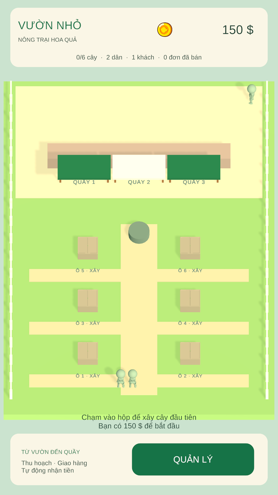
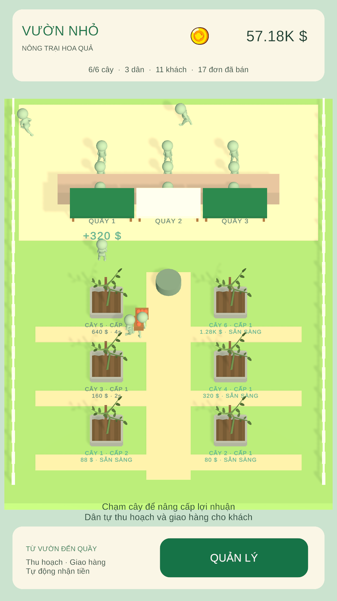
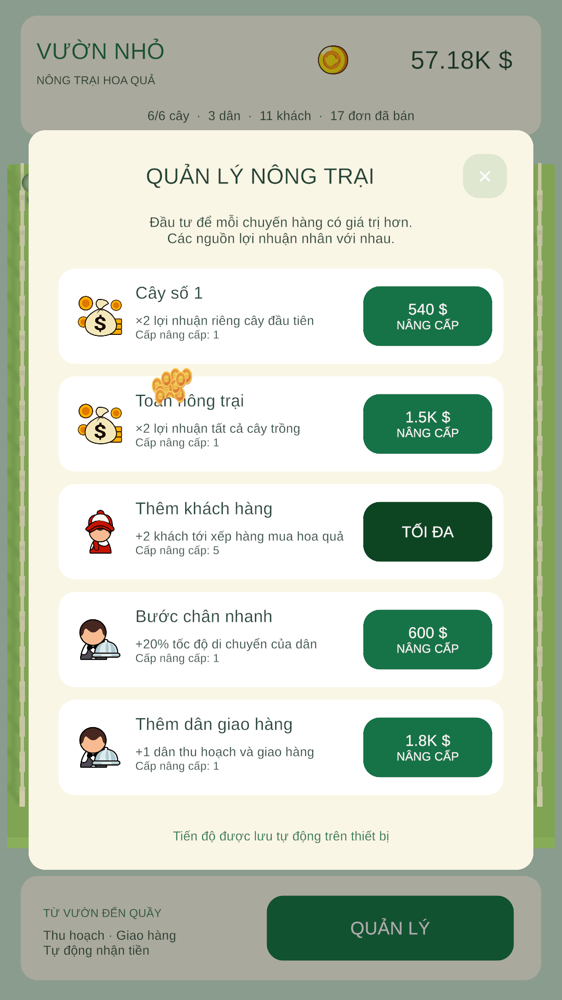

# Vườn Nhỏ — Farm Simulation

Game nông trại 3D dành cho Android, triển khai theo `Requirement.txt` bằng tài nguyên đi kèm.

## Tải game và xem nhanh

- [Tải APK Android v1.0.0](https://github.com/longbale-711/vuon-nho-farm-simulation/releases/download/v1.0.0/VuonNho.apk) · [Trang phát hành](https://github.com/longbale-711/vuon-nho-farm-simulation/releases/tag/v1.0.0)
- **Unity:** 2022.3.62f3 LTS · **Nền tảng:** Android, portrait · **Kiểm thử:** 24/24 EditMode tests đạt.
- [Yêu cầu bài tập](Requirement.txt) · [Báo cáo kiểm thử](Documentation/Validation.md) · [Báo cáo refactor](Documentation/Refactor.md)

<table>
  <tr>
    <td></td>
    <td></td>
    <td></td>
  </tr>
</table>

Clone mã nguồn:

```sh
git clone https://github.com/longbale-711/vuon-nho-farm-simulation.git
```

## Chạy project

1. Mở thư mục này bằng **Unity 2022.3.62f3 LTS** (Built-in Render Pipeline).
2. Mở scene `Assets/Scenes/Farm.unity`, nhấn Play.
3. Game bắt đầu với **150 $**, **1 khách hàng**, **2 dân** và **6 hộp**.
4. Chạm hộp → **Xây cây**; chạm cây → **Nâng cấp**; mở **Quản lý** để mua nâng cấp.

Chọn Game View **1080 × 1920** để xem bố cục dọc đúng yêu cầu. Giao diện tự điều chỉnh theo safe area của thiết bị. Cách ghi “màn hình dọc 1920x1080” trong đề được hiểu là portrait: chiều rộng 1080, chiều cao 1920.

## Cơ chế

| Yêu cầu | Triển khai |
| --- | --- |
| Click hộp → Build → mở hộp → cây | Popup xây cây, animation BoxOpen, hiệu ứng EffBuildDone |
| Click cây → Upgrade | Cấp 2 = 110%, cấp 3 = 120% giá gốc; +10% mỗi cấp |
| Dân tới cây thu hoạch | Trạng thái, đặt chỗ cây, thời gian thu hoạch và chu kỳ mọc quả |
| Giá tính tại thời điểm thu hoạch | `Money` bất biến được gắn vào hàng đang mang; nâng cấp không đổi giá hàng đã hái |
| Ban đầu 1 khách | Khách tới quầy, chờ, thanh toán, rời đi rồi quay lại |
| Giao hàng và nhận tiền | Dân mang giỏ tới quầy của khách đã đặt chỗ; nhận tiền đúng một lần sau giao hàng |
| ×2 lợi nhuận cây 1 | Buff riêng, tăng theo mỗi lần mua |
| ×2 lợi nhuận tất cả cây | Buff toàn cục, nhân với buff riêng và cấp cây |
| +2 khách | Thêm hai nhân vật thật vào hàng chờ, tối đa 11 khách |
| Trạng thái/hành vi/chỉ số/buff nhiều nguồn | Domain riêng, state machines, `StatModifiers` với khóa nguồn |
| Tìm đường ngắn nhất tránh vật cản | A* 8 hướng, heuristic octile, không cắt góc; vật cản mở rộng theo bán kính dân |
| Tiền tệ lớn | `System.Numerics.BigInteger`, lưu bằng chuỗi số nguyên đơn vị cent |

Các bổ sung: tốc độ dân +20% mỗi cấp, thuê thêm dân, lưu tự động mỗi 5 giây/khi tạm dừng/thoát. Không có quảng cáo hay dịch vụ online.

## Cấu trúc module

`Orchard.Domain` không tham chiếu Unity Engine. `Orchard.Runtime` tham chiếu domain, uGUI và TextMesh Pro. Editor và Test nằm trong assembly riêng.

| Vùng | Module và trách nhiệm |
| --- | --- |
| `Assets/Farm/Domain/Currency` | `Money`, `Wallet`: tính tiền chính xác, thanh toán, kiểm soát chi tiêu |
| `Assets/Farm/Domain/Stats` | `Ratio`, `StatModifiers`: tỷ lệ và buff theo nguồn |
| `Assets/Farm/Domain/Crops` | Catalog, thông số, tiến độ cây, giá hiện tại/giá cấp tiếp theo |
| `Assets/Farm/Domain/Management` | Catalog nâng cấp, giới hạn, giá mua và tác dụng buff |
| `Assets/Farm/Domain/Economy` | `FarmEconomy`: phối hợp giao dịch và phát sự kiện thay đổi |
| `Assets/Farm/Domain/Persistence` | Snapshot và kiểm tra dữ liệu tiến độ |
| `Assets/Farm/Domain/Navigation` | Grid và A* thuần C# |
| `Assets/Farm/Modules/Crops` | Vòng đời cây, đặt chỗ thu hoạch, chọn cây theo đường đi |
| `Assets/Farm/Modules/Workers` | Trạng thái thu hoạch, mang hàng và giao hàng |
| `Assets/Farm/Modules/Market` | Khách hàng, hàng chờ, đặt chỗ và quay lại quầy |
| `Assets/Farm/Modules/Movement` | Di chuyển theo waypoint và điều khiển animation |
| `Assets/Farm/Modules/Navigation` | Chuyển đổi grid/world và khai báo vật cản |
| `Assets/Farm/Modules/Persistence` | JSON, migration save cũ, backup, lịch lưu tự động |
| `Assets/Farm/Modules/Presentation` | HUD, popup cây, màn hình quản lý, modal host, UI factory |
| `Assets/Farm/Modules/World` | Dựng thế giới, nhãn và hiệu ứng |
| `Assets/Farm/Modules/Bootstrap` | Kết nối module, resources, sinh nhân vật và input |
| `Assets/Farm/Modules/Verification` | Kịch bản kiểm thử player, chỉ có trong development/editor |
| `Assets/Farm/Editor` | Công cụ tạo scene/font, cấu hình player và build |
| `Assets/Farm/Tests/Editor` | Kiểm thử theo nghiệp vụ và hồi quy save/giao dịch |

Quy ước được lưu trong `.editorconfig`: PascalCase cho type/public member, camelCase cho local/parameter, `_camelCase` cho field instance private, `s_camelCase` cho field static private, Allman braces, access modifier tường minh, một khai báo mỗi dòng. Tham khảo [Microsoft C# coding conventions](https://learn.microsoft.com/en-us/dotnet/csharp/fundamentals/coding-style/coding-conventions) và [identifier conventions](https://learn.microsoft.com/en-us/dotnet/csharp/fundamentals/coding-style/identifier-names).

Comment trong mã nguồn chỉ giữ cho công thức, tìm đường, migration JSON và quy trình import bất đồng bộ. UI không chứa công thức kinh tế; popup lấy giá hiện tại và giá tiếp theo từ domain. Các context interface giới hạn chức năng mà từng module nhân vật/giao diện có thể sử dụng.

Các prefab gốc được giữ nguyên. Game dùng trực tiếp Box, Construction, Delivery, Customer, Market, EffBuildDone, EffPay; UI dùng các sprite từ bộ tài nguyên đã cho. Font Liberation Sans từ TMP Essentials hỗ trợ tiếng Việt. `.meta` của script và assets được giữ khi di chuyển thư mục.

## Build APK

Cài Android Build Support, SDK/NDK và OpenJDK cho Editor. Chọn menu **Orchard → Build Android APK**.

Hoặc dùng Unity CLI:

```sh
unity build . --editor-version 2022.3.62f3 --target Android \
  --execute-method Orchard.Editor.FarmProjectBuilder.BuildAndroid \
  --output-path Builds/Android/VuonNho.apk --allow-dirty-build
```

APK dùng IL2CPP, ARM64 + ARMv7, portrait, Android tối thiểu 6.0, target API 34. Bản APK test ký bằng debug keystore mặc định; bản phát hành lên store cần keystore riêng.

Nếu ADB của bộ SDK cũ bị kẹt dò USB trên macOS, chạy build với biến môi trường `ADB_USB=0` cho phiên đó. Không dùng tùy chọn này khi muốn triển khai qua cáp USB.

## Kiểm thử

Mở **Window → General → Test Runner**, chạy EditMode; hoặc:

```sh
unity test . --editor-version 2022.3.62f3 --mode EditMode \
  --output TestResults/refactor-editmode.xml
```

Bản macOS Development có thể chạy với `-farmVerify` để kiểm tra toàn bộ vòng lặp qua các nút UI, mở 6 cây, nâng cấp, 11 khách, bán liên tục và save ra đĩa. Kịch bản này nằm trong `FarmVerification.cs` và **không được biên dịch vào APK release**. Kết quả local và ảnh render được ghi vào `Builds/Verification/`. Bản kiểm thử đã chạy được lưu trong [Documentation/Tests](Documentation/Tests) và [Documentation/Images](Documentation/Images).

## Lưu và giới hạn

Tiền và nâng cấp lưu tại `Application.persistentDataPath/orchard-save.json`, dùng file tạm rồi thay thế và có `.bak` để phục hồi. Hàng đang giao, thời gian mọc quả và vị trí nhân vật được khởi tạo lại khi mở game; tiền đã nhận và mọi nâng cấp được giữ. Không cộng thu nhập offline.

Tối đa 6 cây, 11 khách, 6 dân; cấp cây tối đa 10.000, buff lợi nhuận tối đa 1.000 lần mua. Những giới hạn này bảo vệ số nhân vật và độ dài phép tính; tiền không giới hạn theo `long`/`double`.

APK demo chỉ là tài liệu tham khảo, được loại khỏi Git và không phải bản build của project này. `Library`, `Temp`, `Builds`, logs và kết quả test local được loại khỏi Git. APK được cung cấp qua GitHub Releases; ảnh và báo cáo kiểm thử đã chọn nằm trong `Documentation/`.
